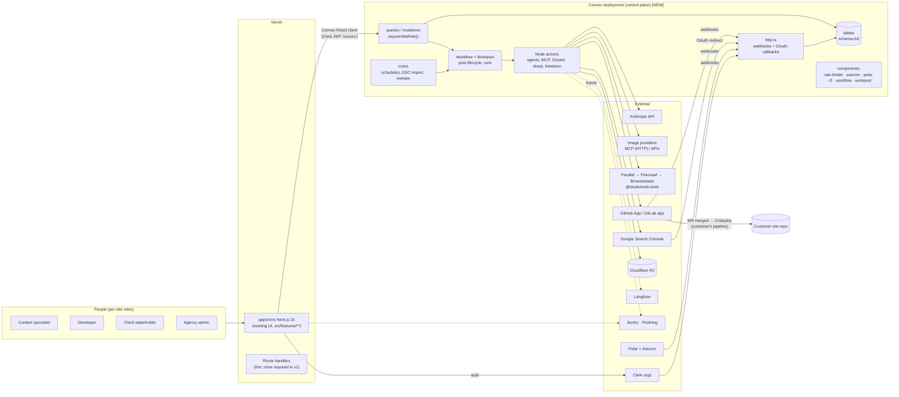
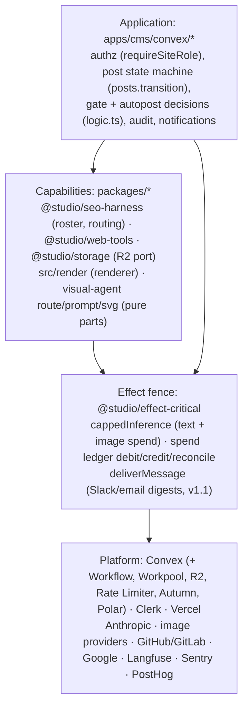
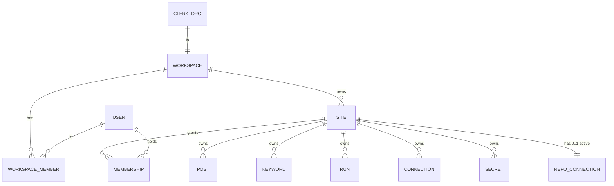
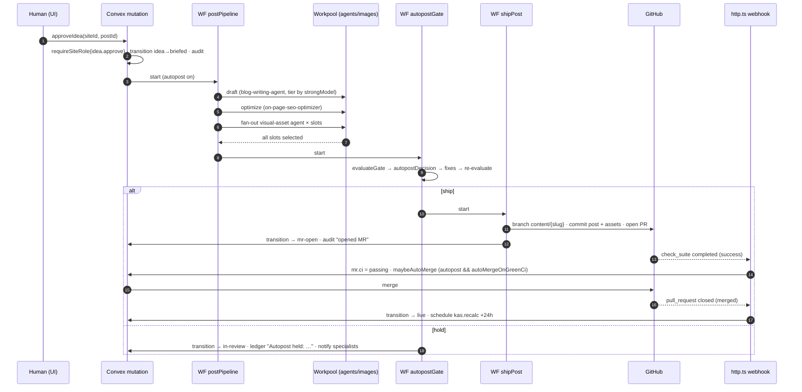
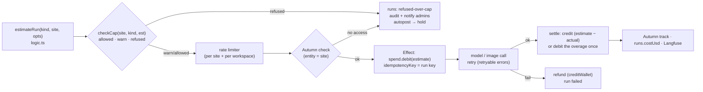

# Agentic CMS: backend blueprint

The backend that replaces the client-side store (`src/lib/store.tsx`, `SIM_MS` timers, `.data/*.json`) with a real
control plane, without changing what the UI shows. Read with: [schema.md](./schema.md) · [api-map.md](./api-map.md) ·
[convex-schema.draft.ts](./convex-schema.draft.ts) · [handoffs/](./handoffs/) · stack decisions in
[../engineering-blueprint.md](../engineering-blueprint.md).

Doctrine it follows: `docs/architecture.md` (layering, Effect fence, client never touches the DB),
`docs/ai-in-workflow.md` (placement A: AI inside the job), `packages/seo-harness/HARNESS.md` (agents, contracts, gates),
`docs/uxer/00-decisions.md` C10–C13 (ideas-only approval, autopost, connections, visual agent).

**[NEW]** marks anything not in the repo today. Provider API specifics are marked "verify against provider docs".

---

## 1. System context



The CMS never deploys anything. It opens one PR per post in the customer's repo; the customer's own CI and deploy run on merge. Under autopost the CMS agent merges its own PR when CI is green (C10); a human-approved PR still waits for a developer.

## 2. Where the code lives

| Path | What | Status |
|---|---|---|
| `apps/cms/convex/` | Schema, functions, workflows, `http.ts`, `crons.ts`, `convex.config.ts` | **[NEW]** (own deployment; decision D1) |
| `apps/cms/convex/lib/access.ts` | `requireSiteRole`, `requireWorkspaceRole`, `effectiveRole` | **[NEW]** |
| `apps/cms/convex/agents/*.ts` (`"use node"`) | Harness agent steps, CMS agent, visual-asset agent | **[NEW]**, ports from `src/server/visual-agent/**` |
| `apps/cms/src/lib/logic.ts` | Pure rules reused on the server unchanged: `evaluateGate`, `autopostDecision`, `nextState`/`TRANSITIONS`, `computeKas`, `concentration`, `pillarDistribution`, `checkCap`, `estimateRun`, `ledgerStatus`, `PERMISSIONS`, `lockReason`, `countWords` | exists, pure. **Clock caveat:** it defaults to `now()` from `./clock`, which is pinned to `DEMO_NOW` (25 Sep 2026) unless `NEXT_PUBLIC_CMS_LIVE_CLOCK=1`. Server code must set that env in Convex or pass `at` explicitly (`ledgerAge(item, at)`, `fmtAgo(iso, at)`); handoff 01 adds a test that fails on a pinned clock. Import by relative path from `convex/` (`../src/lib/logic`); `src/render/*` uses `@/lib/types` but as `import type` only (erased by the bundler), so add the `@/*` path to `convex/tsconfig.json` for typechecking |
| `apps/cms/src/render/**` | Renderer + template parser, DOM injected (`TParseHtml`); linkedom on the server | exists |
| `apps/cms/src/lib/store.tsx` | Becomes a thin adapter: same hooks, backed by `useQuery`/`useMutation` | rewrite in handoff 01–02 |
| `packages/seo-harness` | Roster, `MODELS`, `SCHEDULE`, `IMAGE_ROUTING`, skills | exists; add a skills codegen **[NEW]** (Convex bundles cannot read `SKILL.md` at runtime) |
| `packages/effect-critical` | `debitAndInfer`, `debitCredits`, `creditWallet`, `runInference`, `deliverMessage` | exists; add `cappedInference` (estimate → refuse over cap → debit → infer → retry → settle) **[NEW]** |
| `packages/ai-runtime` | `assertWithinBudget`, `createOpenRouterGateway` | exists; add `createAnthropicGateway` **[NEW]** (decision D2) |
| `packages/observability` | `traceGeneration`, `langfuseConfigFromEnv`, `captureServerException`, `captureServerEvent` | exists; add run-level trace (`traceRun` with parent trace id) **[NEW]** (today each `traceGeneration` makes its own trace) |
| `packages/web-tools` | `searchWeb` (Parallel), `scrapeUrl` (Firecrawl), `createBrowserSession` (Browserbase) | exists |
| `packages/storage` | `StorageProvider`, `createUploadUrl`, `resolvePublicUrl` | exists (Port); implement with the R2 component **[NEW]** |

## 3. Layering (per `docs/architecture.md`)



| Rule | In this product |
|---|---|
| Actions orchestrate; services don't mutate tables | Agent steps (Node actions) return structured results; one internal mutation per step persists them. The visual agent returns candidates; `slotsInternal.setCandidates` writes them. |
| Effect only for money, inference, delivery | Every model call and every paid image call goes through `cappedInference`. Git, templates, gate evaluation do not. |
| Call shape | `action → Effect program → mutation`, exactly as `apps/web/convex/inference.ts` `runMeteredInference` does today. |
| Client never touches the DB | No route handler reads Convex tables with an admin key; the browser calls Convex functions with the Clerk JWT. |

## 4. Tenancy model



| Concept | Backend | Source |
|---|---|---|
| Workspace | One **Clerk organization** = one `workspaces` row (`clerkOrgId`). Active workspace = the JWT's active org. | lead stack; contract §2 `IWorkspace` |
| User | `users` (global; Clerk user). | `IUser` |
| Workspace role | `workspaceMembers.role` ∈ owner·admin·member, mirrored from Clerk org role via webhook. Clerk org roles map: `org:admin` → admin (owner = creator, kept in Convex), `org:member` → member (verify custom role keys in Clerk). | `TWorkspaceRole` |
| Site | `sites` row in the workspace; `slug` unique per workspace. | `ISite.slug` |
| Site role | `memberships.role` ∈ specialist·developer·stakeholder·admin, **Convex-only** (Clerk has no per-resource roles). | `IMembership` |
| **Effective role** | workspace owner/admin → `admin` on every site; else the membership role; no membership → **no access** (`sites.bySlug` returns `no-access`, the UI shows "Request access"). | contract §2 |

### The one helper

```ts
// apps/cms/convex/lib/access.ts  [NEW]
import { PERMISSIONS, type TPermission } from "../../src/lib/logic";

export async function requireSiteRole(
  ctx: QueryCtx | MutationCtx,
  siteId: Id<"sites">,
  permission: TPermission,          // "minRole" from the brief: roles are not ordered (developer can merge, specialist can approve), so the check is by permission key
): Promise<{ user: Doc<"users">; site: Doc<"sites">; role: TRole; workspaceId: Id<"workspaces"> }>;
// 1. identity = ctx.auth.getUserIdentity()          → throw "Not authenticated"
// 2. user = users.by_token(identity.tokenIdentifier) → throw if missing / suspended
// 3. site = ctx.db.get(siteId)                       → throw "Not found" (same message as no-access: no existence oracle)
// 4. workspace = site.workspaceId; must equal the JWT's active org workspace (org_id claim → workspaces.by_clerkOrg)
// 5. role = effectiveRole(workspaceMembers.by_workspace_user, memberships.by_site_user)
// 6. PERMISSIONS[permission].includes(role)          → else throw ConvexError({ code: "FORBIDDEN", reason: lockReason(role, permission) })
```

Actions have no `ctx.db`: they call `internal.access.assertSiteRole` (an internal query wrapping the same function) as their first line, then pass the returned `workspaceId` / `siteId` to everything downstream. Public functions are built with wrappers (`siteQuery`, `siteMutation`, `siteAction`) that inject the check, so a function cannot be registered without one (convex-helpers `customQuery` is one way; verify, or write the 30-line wrapper by hand).

### Isolation rules

| # | Rule | Enforced by |
|---|---|---|
| I1 | Every public site-scoped function takes `siteId` first and calls `requireSiteRole` before any read. | wrappers + lint rule (grep check in CI) + isolation tests |
| I2 | Child reads go through the parent: load `post`, check `post.siteId === siteId`, then children by `postId`. Never trust a child id from the client without that check. | `loadPostInSite(ctx, siteId, postId)` helper |
| I3 | Tenant tables are only queried `withIndex("by_site…")` or via a parent id already checked. No `.collect()` over a whole table in public functions. | review + test |
| I4 | Agent context is built from one site only: brand pack, keywords, prior posts, connections, artifacts all filtered by the run's `siteId`. A run row carries `siteId`; the agent step refuses input whose `siteId` differs. | `buildAgentContext(siteId)` |
| I5 | R2 keys are prefixed `sites/<siteId>/`; URLs are minted only after the caller's site check. | `assets.urlFor(ctx, siteId, assetId)` |
| I6 | Secrets decrypt only inside internal Node actions, for the run's site, and never enter prompts, logs, audit or Langfuse. | `secretsInternal.get(siteId, ownerKind, ownerId)` |
| I7 | Webhooks resolve tenant from the provider payload (installation + repo → `repoConnections`; checkout metadata → site), never from a query string. | `http.ts` |
| I8 | Same error for "doesn't exist" and "not yours". | `requireSiteRole` step 3 |

## 5. Data ownership

| Data | Owner (writes) | Readers | Notes |
|---|---|---|---|
| Workspace, users, workspace roles | Clerk (truth) → `/clerk/webhook` → Convex | all members | Convex never invents an org; `sites.add` needs an existing workspace |
| Site membership & site roles | Convex (`members.*`) | members | not mirrored to Clerk |
| Post state | **CMS agent** via `posts.transition` only | everyone on the site | humans trigger transitions through mutations that call it |
| Post content (blocks, versions) | writer agents (versions), humans (`editor.*`), autopost fixes (as accepted suggestions) | all roles | every change = a version row |
| Gate checks | on-page optimizer agent; overrides by humans | all | derived checks computed on read |
| Slots, candidates, assets | visual-asset agent; human uploads | all | provenance on every candidate |
| Template manifests/files | developer upload → parser | all (preview) | renderer reads confirmed only |
| Merge requests | CMS agent (open, rebase, auto-merge); GitHub webhooks (ci, status) | all | the only repo writer is `gitNode.*` |
| Runs | workflow/Workpool steps | all (`plan.view`) | billable record |
| Spend ledger | `spend.debit/credit` (Effect adapter) | admins (full), others (pct only) | truth; Autumn is the commercial meter |
| Keywords, positions, traffic | GSC import + swarm agent (new keywords) | all | |
| KAS snapshots, reports | `kas.recalc`, report agent | all | append-only |
| Ledger items | QA agent, autopost holds, system; humans resolve | all | |
| Audit | every mutation (append-only) | `audit.view` | no update/delete function exists |
| Connections + secrets | admins (`routing.set`) | agents (internal) | |

## 6. Post lifecycle

States and transitions are `TRANSITIONS` in `src/lib/logic.ts` (unchanged). The backend adds who/what moves each edge.

```mermaid
stateDiagram-v2
  [*] --> idea: addIdea / keyword swarm / KAS gap / refresh
  idea --> idea: rejectIdea (ideaStatus=rejected, leaves the plan)
  idea --> briefed: approveIdea / promoteToBrief (HUMAN: idea.approve)

  briefed --> drafting: postPipeline.draft (autopost) or generateNow / publish-slot cron
  drafting --> needs_assets: draft + optimizer done, slots created
  needs_assets --> needs_assets: visual-asset agent fills slots (Workpool)

  state autopost_branch <<choice>>
  needs_assets --> autopost_branch: all slots filled (or shipNow)
  autopost_branch --> gate: site.publishing.autopost = on
  autopost_branch --> in_review: autopost = off

  state gate {
    [*] --> evaluate: evaluateGate()
    evaluate --> fix: autopostDecision().fixes
    fix --> evaluate: re-evaluate after agent fixes
    evaluate --> ship: action = ship
    evaluate --> hold: action = hold
  }
  gate --> in_review: ship → transit (no needs-assets→mr-open edge in TRANSITIONS)
  in_review --> mr_open: shipPost (render → branch → PR), autopost or human approve
  gate --> in_review: hold → ledger "Autopost held: reason"

  in_review --> drafting: sendBack(note) → revise workflow
  in_review --> in_review: approve (HUMAN: post.approve, gate re-checked server-side) starts shipPost
  in_review --> in_review: edits (new version)

  mr_open --> mr_open: CI red (stays open, timeline shows ciDetail) / rebaseMr / conflict
  mr_open --> live: merged (webhook) — autopost MR auto-merges on green CI if autoMergeOnGreenCi; human-approved MR waits for mergeMr (HUMAN: mr.merge)
  mr_open --> in_review: post edited after MR opened (approvedVersion stale)

  live --> decaying: GSC rollup flags decay / content-refresh agent
  decaying --> drafting: generateNow (refresh)
  live --> [*]
```

Hold reasons the gate can return (`autopostDecision` in `logic.ts`): autopost off, no repo, no confirmed manifest / template can't render (fidelity rule), over cap, provider failure, a person's human-only slot, an unfixable hard check. Soft blocks are accepted with `AUTOPOST_SOFT_REASON`. Every agent action under autopost is audited as `AUTOPOST_ACTOR`.

### Workflow segmentation

The lifecycle is **not** one long-lived workflow. It is a chain of short workflows started by events, so a human pause (review, merge) is a row state, not a sleeping workflow (works whether or not the Workflow component's event-wait API fits; verify `awaitEvent` support before relying on it).



Concurrency: `posts.workflowId` holds the live workflow; starting another for the same post is refused. `posts.transition(postId, from, to)` checks `from` (optimistic), so a late step from a cancelled workflow can't move a post a human already moved.

## 7. Scheduling

| Source | Mechanism | Notes |
|---|---|---|
| Per-site schedules (`ISchedule`, defaults from `@studio/seo-harness` `SCHEDULE` and PRD "Scheduled triggers") | `schedules` rows + one cron `schedules.tick` every 5 min | per-site timezone, pause per schedule and per site (`sites.status = paused`) |
| Per publish slot | inside `schedules.tick`: briefed posts whose `week` is now | `generateNow` is the manual twin |
| Post-merge KAS | `ctx.scheduler.runAfter(24h, kas.recalc)` from `afterMerge` | then weekly via schedule |
| Manual `runNow(kind)` | same `scheduledRun` workflow as the cron | PRD goal 5: identical output |
| Maintenance | static crons in `crons.ts` (api-map §12) | |

Default schedule rows on `sites.add`:

| kind | rule | agents (harness) |
|---|---|---|
| `keyword-swarm` | weekly Mon 07:00 | keyword-research-swarm |
| `post-generation` | per publish slot | blog-writing-agent → visual-asset-agent → on-page-seo-optimizer → CMS agent |
| `technical-monitor` | weekly Fri 07:00 | technical-seo-monitor |
| `qa-sweep` | weekly Fri 09:00 light, biweekly Fri full | seo-qa-agent |
| `content-refresh` | monthly day 1 | content-refresh-agent |
| `link-prospecting` | monthly day 1 | link-building-prospector |
| `biweekly-report` | biweekly Fri after QA | visualization-report-agent |
| `kas-recalc` | weekly + 24 h post-merge | (deterministic, no model) |

The harness orchestrator (#0, Haiku "dispatcher") is **replaced by deterministic code**: `schedules.tick` + workflow preconditions + "newest artifact" lookups. No model call is needed to route (decision D6). Its job "log gaps to QA ledger" becomes: a step with missing mandatory inputs writes a `ledgerItems` row (escalation rule 1) instead of guessing.

## 8. Agent execution model

| Concept | Implementation |
|---|---|
| Harness agent = workflow step | A Node action `agents.<id>.run({ siteId, runId, inputs })` per agent in `packages/seo-harness` `AGENTS`. It builds context for one site (I4), calls the model through `cappedInference`, validates the structured output, returns it. The workflow's next `step.runMutation` persists it. |
| CMS agent = orchestrator | Not an LLM loop: it is the workflows + `posts.transition` + `gitNode.*` (the only repo writer, per `CMS_AGENT` in `@studio/seo-harness`). It calls a model only for autopost fixes (rewrite unsourced claim, fixable checks) via the writer/optimizer prompts, tier `CMS_AGENT.modelTier` (`workhorse`). |
| Prompts = harness skills | `packages/seo-harness/skills/<id>/SKILL.md` compiled into `skills.generated.ts` at build time **[NEW]** (Convex can't read package files at runtime). System prompt = skill text + site brand pack + guardrails; user content = the step's typed inputs. Skill version hash stored on the run. |
| Structured outputs | Each agent step declares a zod schema for its artefact (e.g. writer → `{ blocks, facts[], imageSheet[], wordCount }`, optimizer → `IGateCheck[]`, swarm → keyword rows). Use Anthropic structured outputs as the prototype does (`zodOutputFormat` from `@anthropic-ai/sdk/helpers/zod` in `src/server/visual-agent/diagram.ts`); validate again server-side; reject on mismatch. |
| Model tier routing | `site.modelRouting` (`mechanical`·`writing`·`strategy`·`pillar-pages` → tier) → `MODELS[tier]` from `@studio/seo-harness` (`fast: claude-haiku-4-5`, `workhorse: claude-sonnet-5`, `strongest: claude-opus-5-5`; verify ids at docs.claude.com before deploy, as harness-config says). |
| Escalation | Static, from `harness-config.yaml` `escalate_to`: writer → strongest for `pillar_page`/`money_page` (`post.strongModel`), report → strongest on `pivot_trigger_fired`, technical monitor → workhorse on `ambiguous_diagnosis`. Dynamic (proposed, D7): invalid structured output → retry once same tier → escalate one tier if `checkCap` still allows → else run fails and the post holds. |
| Turn & spend budget | `assertWithinBudget` from `@studio/ai-runtime` before every model turn of a multi-turn step (tool use). `maxTurns` per agent in code (no default, as the package demands). |
| Tools | Web research via `@studio/web-tools` (`searchWeb` → `scrapeUrl` → `createBrowserSession`, in that cost order); image providers via HTTP MCP / APIs (visual agent). No arbitrary code execution, so no sandbox is required (`@studio/ai-runtime` sandbox stays a Port). Agent-produced SVG passes `sanitizeSvg()` (`src/server/visual-agent/svg.ts`). |
| Guardrails | Content: fact markers for unsourced claims, regulated disclaimers, no invented credentials (writer skill + gate). Images: `IMAGE_ROUTING` + visual-asset guardrails in `harness-config.yaml` (no real people, no living-artist style, no watermarks, license checks, provenance, estimate before run, secrets never in prompts). |

## 9. Integrations

| Integration | Where | Auth | Notes |
|---|---|---|---|
| Clerk | client + `/clerk/webhook` | JWT template `convex` (as `docs/fellow-day-0.md` Tier A) + org claim | Organizations feature must be on; active org required in the CMS |
| Anthropic | `agents/*` Node actions | `ANTHROPIC_API_KEY` (Convex env, Studio-owned) | per-tenant LLM key optional via `connections` kind `llm` (prototype supports `anthropic` provider) |
| Image providers | `agents/visualAsset` | per-site `connections` + `secrets` | **HTTP MCP only** (streamable-http, SSE fallback) via `@modelcontextprotocol/sdk`; stdio rejected (prototype allows it behind `CMS_ALLOW_STDIO_MCP=1`) |
| Web sources | visual agent `source` route, research | Openverse/Wikimedia/stock via `connections`; Parallel/Firecrawl/Browserbase via Studio keys | license filter `acceptLicense()` |
| GitHub App | `gitNode.*` (Octokit), `/github/webhook`, `/github/setup` | App id + private key; installation tokens minted per call (verify token lifetime) | permissions: contents RW, pull requests RW, checks R, metadata R (verify minimal set). App permissions are repo-wide; **path scope is enforced by the CMS** (commit builder allowlists `contentDir`, `assetDir`, `indexFiles`) and recommended repo rulesets (D8) |
| GitLab app | v1 (after GitHub) | OAuth app / group access token (verify) | `merge_request`, `pipeline` hooks |
| Search Console | `gsc.*`, `/oauth/google/callback` | Google OAuth PKCE (port of `apps/web/convex/googleWorkspace*.ts` + `lib/googleOAuth.ts`) | scope: Search Console read-only (verify scope string); Search Analytics daily import; URL submission only if an API supports it for blog posts (verify; may reduce to sitemap ping) |
| R2 | `@convex-dev/r2` component **[NEW]** | R2 keys in Convex env | template bundles, assets, report HTML |
| Polar | `@convex-dev/polar` (in apps/web today) | `POLAR_*` | subscription per site (D3) |
| Autumn | `@useautumn/convex` (in apps/web today) | `AUTUMN_SECRET_KEY` | credits meter; customer = workspace, entity = site (D4) |
| Langfuse | `@studio/observability/langfuse` | `LANGFUSE_*` | one trace per run |
| Sentry / PostHog | `@studio/observability` (`captureServerException`, `captureServerEvent`) | DSN / key | server capture from actions |

## 10. Secrets

| Item | Design |
|---|---|
| Storage | `secrets` table: AES-256-GCM ciphertext, `keyVersion`, `hint`. Port the WebCrypto implementation from `apps/web/convex/lib/googleOAuth.ts` (`encryptGoogleSecret`/`decryptGoogleSecret`, 32-byte base64 key) rather than the prototype's Node `secret-box.ts` (SHA-256 stretched passphrase), so it runs in the default Convex runtime too. |
| Key | `CMS_SECRETS_KEY_V1` (32 bytes base64) in Convex env; `CMS_SECRETS_KEY_CURRENT=1`. Rotation: add `V2`, re-encrypt job, retire `V1`. |
| Per tenant | Every row has `siteId`; `secretsInternal.get(siteId, …)` refuses cross-site reads. Optional later: per-workspace data keys wrapped by the master key. |
| Never | returned by a public function · logged · put in prompts · sent to Langfuse/Sentry · stored in `connections` · rendered after entry (only `hintOf()`). |
| Studio-level keys | Anthropic, GitHub App private key, Google OAuth client, R2, Langfuse, Polar, Autumn, Parallel/Firecrawl/Browserbase: Convex env per deployment tier (handoff 00). |

## 11. Spend



| Rule | Source |
|---|---|
| Two budgets per site per month: text, image. Caps in USD, set by admin (`budget.set`). | PRD "Cost controls", `ISite.budgets` |
| Every run shows and checks its estimate first; over cap refuses with a message, never bills silently. Alert at 80% (`CAP_WARN_RATIO`). | PRD guardrails, `checkCap` |
| Ledger truth = `spendEntries` (integer micro-USD) behind `@studio/effect-critical`; `sites.spend` cache updated in the same mutation. Autumn = commercial meter, reconciled daily. | `docs/architecture.md` "Credit ledger truth" |
| Pre-debit the estimate, settle to actual: the `debitAndInfer` refund-on-failure semantics extended with settle-on-success, in `cappedInference` **[NEW]**. | `packages/effect-critical/src/meteredInference.ts` |
| Server-built idempotency keys only. | `apps/web/convex/inference.ts` comment |
| Studio pays the model providers; customers pay via Polar subscription + Autumn credits. Per-tenant provider keys (connections) are billed by that provider to the customer: still estimated and capped, but debited to the site ledger as `0` provider cost + optional CMS fee (D15). | |

## 12. Observability

| Signal | Where | Content |
|---|---|---|
| Langfuse trace per run | `traceRun` **[NEW]** wrapping `traceGeneration` | trace id on `runs.langfuseTraceId`; spans per model call / tool call; metadata `siteId`, `workspaceId`, `agentId`, `tier`, `skillHash`; **no secrets, no PII beyond site domain** |
| Sentry | `captureServerException` in action catch blocks; client `@sentry/nextjs` | tags `siteId`, `runId`, `workflowId` |
| PostHog | `captureServerEvent` for job outcomes; client pageviews | events: `idea_approved`, `post_shipped`, `post_held` (`reason`), `mr_merged` (`autopost`), `run_refused_over_cap`, `slot_filled` (`route`) |
| Audit | `auditEvents` | the customer-facing trail ("who approved this claim" = one query by `by_post_at`) |
| Runs | `runs` | cost, tokens, model, status: per-client cost reporting |
| Health | Convex dashboard + `stats.site` | failing workflows, open holds |

## 13. Failure handling

| Failure | Behaviour |
|---|---|
| Model call fails (retryable: 429/5xx/timeout) | Effect retry with backoff (bounded, e.g. 3) inside `cappedInference`; then refund, run `failed`, workflow step fails → workflow retry policy (bounded) → post holds with "Provider failure" ledger item. |
| Invalid structured output | retry once, escalate one tier (D7), else fail as above. |
| Image provider fails | visual agent: retry once, next route, else hold slot (ledger item), per SKILL "Failure handling" and `runVisualAgent` today. |
| Over cap mid-pipeline | step refuses before calling; post holds "over cap"; no partial charge. |
| Template can't render (fidelity) | `renderPost().held` non-empty → hold "Template can't render: <structure>", ledger item to developer. |
| Git: branch exists / PR exists | idempotent: find by head branch and update. |
| Git: base moved, conflict | `rebaseMr` re-renders from current manifest; unresolvable → `status: conflict`, `conflictDetail`, notify developer, never force onto base. |
| CI red | MR stays open, `ciDetail` on the post timeline, notify; autopost does not merge. |
| Webhook replay / out of order | `webhookEvents` dedupe; MR updates compare `headSha` and ignore stale events. |
| GitHub App uninstalled / repo removed | `repoConnections.status = removed`, posts hold "No repo", notify admins. |
| GSC token expired | `reconnect_required`, `sites.searchConsole = expired`, KAS shows `DataGap` (never zeros). |
| Workflow step crash | component retries; steps are idempotent (keys above); `posts.transition` from-state check protects against duplicates. |
| Partial secrets outage (key missing/wrong) | decrypt throws a typed error → connection `failed` with a human sentence (as `SecretUnavailableError` today), runs hold. |

## 14. What stays in Next.js vs Convex

| Concern | Next.js (`apps/cms`, Vercel) | Convex |
|---|---|---|
| UI, routing `/s/[site]/…`, redirects, `middleware.ts` (Clerk) | ✅ | |
| Auth session | Clerk (`@clerk/nextjs`) | verifies JWT (`auth.config.ts`, as `apps/web/convex/auth.config.ts`) |
| All reads/writes of product data | | ✅ |
| Agents, MCP clients, Octokit, sharp, linkedom parse/render | | ✅ Node actions |
| Webhooks, OAuth callbacks | | ✅ `http.ts` |
| File upload | browser → R2 signed URL (minted by Convex) | ✅ |
| Preview page `/preview/[site]/[postId]` | ✅ renders HTML returned by `render.preview` into a sandboxed iframe | ✅ produces the HTML |
| `app/api/connections/**`, `app/api/templates/**`, `app/api/visual-agent/run` | **deleted** after their Convex equivalents ship (they are localhost-only today: "LOCALHOST PROTOTYPE: auth … must be enforced") | ✅ |
| Long-running work | never (Vercel `maxDuration` 300 today on `visual-agent/run`) | ✅ Workflow/Workpool |

## 15. Open decisions

| # | Decision | Options | Recommendation | Blocks |
|---|---|---|---|---|
| D1 | Convex deployment | own `apps/cms/convex` · share `apps/web`'s | **Own.** Different tenancy model (orgs + per-site roles) and data; `apps/web` users/wallets are keyed by user. | 01 |
| D2 | Model gateway | Anthropic API direct (new `createAnthropicGateway`) · Anthropic models via OpenRouter (framework default) | **Direct**: harness pins Anthropic ids; prototype already uses `@anthropic-ai/sdk` structured outputs. OpenRouter stays a fallback adapter. | 03 |
| D3 | Billing unit | Polar subscription **per site** (lead) · per workspace (`IWorkspace.plan` + `seats` in the contract) | Needs product call. Schema supports both: `siteSubscriptions` + `workspaces.plan`. Suggest workspace plan (seats) + per-site subscription item. | 08 |
| D4 | Autumn mapping | customer = workspace, entity = site · customer = site | **Workspace + entity per site** (verify Autumn entity semantics; `createEntity` is exported in `apps/web/convex/autumn.ts`). | 08 |
| D5 | Auto-merge | CMS merges on `check_suite` success webhook · GitHub native auto-merge | **CMS-driven**: re-checks gate for `postVersion`, audits as `AUTOPOST_ACTOR`, works the same on GitLab. | 06 |
| D6 | Orchestrator agent #0 | keep Haiku dispatcher · deterministic crons/workflows | **Deterministic** (no routing tokens, testable). Harness stays portable; only the CMS replaces #0. | 02, 03 |
| D7 | Dynamic escalation | none · retry → escalate one tier within cap | **Retry → escalate**, logged on the run (`escalated: true`). | 03 |
| D8 | Path scope enforcement | CMS allowlist only · also require a repo ruleset / CODEOWNERS on content paths | **Both**: allowlist is mandatory; setup checklist asks the developer to protect the base branch with required checks (verify ruleset options). | 06 |
| D9 | `resolveLedgerItem` permission | store has none | `post.edit` (specialist/admin) + item owner. | 01 |
| D10 | Undo | generic undo · inverse mutations for reversible actions only | **Inverse mutations only** (api-map §9). | 01 |
| D11 | Stats at scale | bounded queries · Aggregate component | Bounded queries for v1; Aggregate when a site passes ~2k posts. | 09 |
| D12 | Stakeholder as approver (PRD Q7) | never · per-site delegation | Keep agency-side (current `PERMISSIONS`). | — |
| D13 | Template drift (PRD Q6) | re-render history · new posts only | **New posts + open MRs** (rebase re-renders); live posts untouched. | 05 |
| D14 | Image licensing policy (PRD Q5) | policy per provider | Needed before `source`/`generate` routes are on by default for paying clients. | 04 |
| D15 | Cost model (PRD Q8) and customer-key billing | per post · per site · usage | Drives cap defaults and Autumn features. | 08 |
| D16 | Presence | own table · `@convex-dev/presence` component | Own table (tiny), revisit if presence grows. | 01 |
| D17 | Indexing submission after merge (PRD Module 5) | API submission · sitemap ping · none | Verify what Google exposes for blog URLs; do not promise "submitted for indexing" until verified. | 07 |

## 16. Where this contradicts the prototype or the PRD

| # | Prototype / PRD says | Backend does | Why |
|---|---|---|---|
| X1 | PRD non-goal: "The CMS opens merge requests; humans merge" | auto-merge of **autopost** MRs on green CI | founder direction C10 (27 Sep) supersedes; harness rule 4 |
| X2 | PRD stack: Postgres + queue | Convex + Workflow/Workpool | constraint C2 |
| X3 | Brief: `requireSiteRole(ctx, siteId, minRole)` | `requireSiteRole(ctx, siteId, permission)` | roles aren't ordered: developer merges but can't approve, specialist approves but can't merge (`PERMISSIONS`) |
| X4 | `INotification` list is per site, with one shared `read` flag | notifications per recipient | multi-user: one person reading shouldn't clear it for everyone |
| X5 | `undo()` is generic, one level, client-side | inverse mutations for a reversible subset only (D10) | approvals, merges and runs can't be undone server-side |
| X6 | Current user per tab; `signInAs`, `setRole` role switcher | Clerk session; dev-only impersonation | real auth |
| X7 | MCP stdio allowed with `CMS_ALLOW_STDIO_MCP=1` | HTTP MCP only | constraint C5 |
| X8 | Secrets: `CMS_SECRET_KEY` passphrase, SHA-256-stretched, Node crypto, `plain:` fallback | 32-byte versioned key, WebCrypto AES-GCM, **no plaintext fallback** | rotation + runs in any Convex runtime |
| X9 | `ITemplateManifest.output` offers mdx/json/component; renderer emits HTML only | serializers [NEW] (handoff 05); `component` refused until built | don't advertise what isn't rendered |
| X10 | `ingestTemplate(…, parsed)` stores the browser parse | server re-parses; client parse is a hint | never trust client-side parse for publish |
| X11 | `resolveLedgerItem` has no permission guard | `post.edit` + item owner (D9) | stakeholders are comment-only (PRD) |
| X12 | `src/lib/clock.ts` pins time to 25 Sep 2026 | server runs with `NEXT_PUBLIC_CMS_LIVE_CLOCK=1` or passes `at` | ledger ages and "x ago" would be wrong |
| X13 | `IPost.editingBy`, `ISite.repo`, `ISite.budgets.*Usd`, `IPost.slotIds`, `daysInState`, `ageDays` stored on the object | joins / derived (schema.md) | write contention + single source of truth |
| X14 | Harness orchestrator #0 is a Haiku agent | deterministic crons + workflows (D6) | routing needs no model |
| X15 | Harness agents write "dated files in a shared reports folder" | `artifacts` table (+ R2) per site | multi-tenant, queryable, no shared folder |
| X16 | `src/server/*` imports `server-only`; `src/render/*` imports `@/lib/types` | ported files drop `server-only`; `@/*` path added to `convex/tsconfig.json` (type-only imports) | `server-only` throws outside an RSC bundle |
| X17 | PRD "submits the URL for indexing" after merge | only if a supported API exists (D17) | don't promise unverified provider behaviour |
| X18 | Wallet in `apps/web` is per user | spend ledger per site + budget kind | PRD caps are per client, per text/image |
